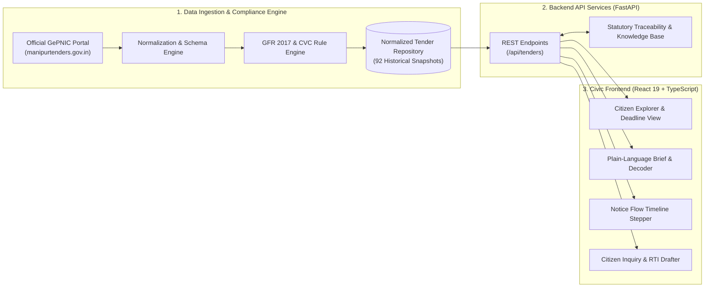

# CHEIRAP (ꯆꯩꯔꯥꯞ)

> **Public Tender Transparency & Civic Vigilance for Manipur**  
> *"See what public money is buying."*

[](https://opensource.org/licenses/MIT)
[](https://mybharat.gov.in/vbyld-2027)
[]()
[]()


---

## Project Overview

**CHEIRAP** (Meetei Mayek: `ꯆꯩꯔꯥꯞ`, historically referring to the traditional court of justice and civic assembly in Manipur) is an autonomous, open-source public procurement transparency platform. It transforms complex, fragmented government e-tender notices into understandable, comparable, and source-verified citizen briefs.

* **Competition**: **Hack for Social Cause (HSC 2027)** under **Viksit Bharat Young Leaders Dialogue (VBYLD)**
* **Organized by**: Ministry of Youth Affairs & Sports (MoYAS), Government of India
* **Knowledge Partner**: Indian Institute of Technology Bombay (GISE Hub & SJMSoM)
* **Thematic Area**: **Theme 4: Governance & Civic Technology** *(with cross-impact on Theme 7: AI & Emerging Tech and Theme 6: Digital Inclusion)*
* **Team Name**: **Team Lotux** (Manipur)
* **Team Members**:
  * Waikhom Preety Devi
  * Yumnam Adit Singh

---

## The Problem: The Civic Procurement Gap

Public procurement accounts for nearly **20% to 25% of India's GDP**, funding critical schools, roads, medical centers, and public infrastructure. In Manipur, a border state where logistical costs and infrastructure resilience are paramount, every public rupee counts.

While official portals like the National Informatics Centre (NIC) GePNIC (`manipurtenders.gov.in`) make tender notices *technically available*, they remain *practically inaccessible* to citizens, journalists, and community leaders:

1. **Information Asymmetry**: Notices are buried in technical codes, multi-page PDFs, and fragmented portal pages.
2. **Compressed Bidding Windows**: High-value tenders are often modified by rapid, consecutive corrigenda, compressing the remaining bidding window to less than 72 hours, which restricts fair participation without formally violating portal defaults.
3. **Absence of Plain Language**: Procurement legalisms obscure basic questions: *Who is procuring? What is being bought? How much money is involved? Where is the site?*
4. **Linguistic Exclusion**: Lack of bilingual access in the constitutional **Meetei Mayek** script alongside English.

```
[Official Portal PDF] -> [Dense Legal Jargon] -> [Information Gap] -> Irreversible Contracts
                                                       │
                                                [CHEIRAP LAYER]
                                                       │
                                          Actionable Civic Transparency
```

---

## The Solution: What CHEIRAP Does

CHEIRAP acts as an intelligent comprehension layer between complex government portals and public questions. It adheres to **CVC (Central Vigilance Commission)** guidelines and **General Financial Rules (GFR 2017 Rule 161)** without ever making accusatory or speculative claims.

### Core Features

* **Citizen Tender Explorer**: Search and filter Manipur tenders across departments, districts, values, and closing dates with an intuitive **Deadline View**.
* **Plain-Language Executive Brief**: Converts 80-page tenders into 4 clear citizen anchors:
  * *Who is procuring?* (Department & administrative chain)
  * *What is being bought?* (Scope & deliverables)
  * *Where is it located?* (District & PIN code)
  * *What does the budget mean?* (Estimated expenditure, EMD security, tender fee)
* **Visual Notice Flow Timeline Stepper**: A continuous 4-stage milestone progression (Notice → Amendments → Submission Closes → Technical Opening) that highlights when post-corrigendum response windows are compressed below 72 hours (CVC / GFR Rule 161).
* **Peer Comparison Benchmark**: Automatically benchmarks a tender's duration and estimated expenditure against historical tenders from the same department to contextualize outliers.
* **Citizen Action & Inquiry Generator**: One-click generation of polite, evidence-based inquiry letters citing specific Tender IDs, dates, and official URLs for RTI (Right to Information) filings or community oversight.
* **Bilingual Meetei Mayek Support**: Complete rendering in the indigenous Meetei Mayek script (`ꯆꯩꯔꯥꯞ`) alongside English for genuine regional inclusion.
* **100% Provenance & Source Traceability**: Direct one-click verification links back to the original `manipurtenders.gov.in` record.

---

## Product Walkthrough & Differentiating Features

### 1. Citizen Tender Explorer & Deadline View
*Intuitive search with live department filtering, deadline calendar views, and objective CVC vigilance chips.*


### 2. Tender Transparency Brief & Plain-Language Decoder
*Decodes dense 80-page procurement documents into 4 essential citizen anchors with instant official portal verification.*


### 3. Visual Timeline Stepper & Corrigenda Window Tracker
*Maps the lifecycle from notice to opening, alerting citizens when late corrigenda compress the bidding window below 72 hours.*


### 4. Departmental Peer Comparison Benchmark
*Compares tender durations and budgets against historical departmental averages to identify unusual compression or inflation.*


### 5. Citizen Action: Source-Cited Inquiry & RTI Drafter
*Empowers citizens, journalists, and CSOs to generate polite, clause-cited inquiry drafts with zero legal barrier.*


---

## Technical Design Document (TDD)

### 1. Architectural Blueprint



### 2. Core Subsystems

1. **Ingestion & Normalization Engine**: Ingests multi-table HTML and PDF records from NIC GePNIC, extracting 32 standardized attributes including work description, estimated expenditure, dates, EMD security deposits, and corrigenda logs.
2. **Statutory Vigilance Rule Engine**: Evaluates tender timelines against statutory thresholds:
   * **GFR 2017 Rule 161**: Evaluates whether the bidding window meets minimum response times (minimum 21 days for standard open tenders; 14 days under documented urgency).
   * **CVC Office Order 01/01/2021**: Detects substantial tender amendments issued close to deadline that fail to provide a compensatory extension (flagging windows compressed below 72 hours).
   * **Vigilance Scoring Metric**: Normalizes risks into a calm 0 to 100 score, categorized into low (Green), medium (Amber), or high vigilance review (Red).
3. **Local-First Privacy Architecture**: Bookmarks, personal notes, and draft RTI inquiry letters are processed entirely in browser client-side storage (`localStorage`). No citizen tracking, personal profiling, or surveillance logs are created on the server.

### 3. Technology Stack
* **Frontend**: React 19, TypeScript, Vite, Tailwind CSS v4, Lucide Icons, GSAP (GreenSock) for accessible UI motion.
* **Backend**: FastAPI, Uvicorn, Python 3.12, Pydantic schemas.
* **Storage & Privacy**: Zero server tracking; bookmarks, private notes, and draft inquiries remain securely in the citizen's browser storage.
* **Performance**: Sub-100ms local interaction response; fully responsive across desktop, tablet, and mobile.

---

## Getting Started

### Prerequisites
* **Node.js**: v18+ (v20+ recommended)
* **Python**: 3.10+
* **Git**

### Installation

1. **Clone the repository**:
   ```bash
   git clone https://github.com/haapuchu/cheirap.git
   cd cheirap
   ```

2. **Configure Environment Variables**:
   Copy the provided environment template:
   ```bash
   cp .env.example .env
   ```
   Default environment variables:
   | Variable | Default Value | Purpose |
   | :--- | :--- | :--- |
   | `PORT` | `8000` | Backend API port |
   | `HOST` | `0.0.0.0` | API bind address |
   | `CORS_ORIGINS` | `http://localhost:5173` | Allowed frontend client origins |
   | `VITE_API_URL` | `http://localhost:8000` | Frontend backend API URL |
   | `VITE_STATE_PORTAL` | `manipurtenders.gov.in` | Target official state portal |

3. **Install Python backend dependencies**:
   ```bash
   pip install -r requirements.txt
   ```

4. **Install Frontend dependencies**:
   ```bash
   cd web
   npm install
   cd ..
   ```

### Running Locally

1. **Start the FastAPI Backend Service** (Port 8000):
   ```bash
   python -m uvicorn server.app:app --host 0.0.0.0 --port 8000 --reload
   ```

2. **Start the Vite Frontend Dev Server** (Port 5173):
   ```bash
   npm --prefix web run dev
   ```

3. **Open the App**:
   Navigate to [http://localhost:5173](http://localhost:5173) in your browser.

---

## Sample Data & Test Cases

### Sample Dataset
The repository includes a curated, 92-tender snapshot from Manipur's official e-procurement portal located at:
* [`web/src/data/tenders_scored.json`](web/src/data/tenders_scored.json)

This dataset covers active and awarded procurements across Public Works (PWD), Education, Medical & Health, Public Health Engineering (PHED), Power Distribution (MSPDCL), and Forest Conservation.

### Running Automated Test Cases
An automated unit test suite validates data schemas, GFR/CVC scoring algorithms, and API endpoints:
```bash
python -m unittest tests/test_tenders_api.py
```

Test coverage includes:
* **Schema Integrity**: Verifies all required fields (Tender ID, title, department, estimated value, dates, risk score) exist and conform to typing rules.
* **Statutory Compliance Bounds**: Validates that all computed vigilance risk scores stay strictly within the normalized 0 to 100 boundary.
* **API Service Verification**: Asserts that `/api/health` and `/api/tenders` endpoints return correct status codes and structured payloads.

---

## Sample Demonstration Tenders

* **Tender ID `MAN_ED_PROC_2026_0142`**: *Procurement of Prefabricated Modular Infrastructure & Labs for Secondary Schools* (₹4.82 Cr, 3 Corrigenda, short response window).
* **Tender ID `2026_MSPDC_3473_1`**: *High-voltage power supply distribution works* (Complete timeline stepper lifecycle).
* **Tender ID `2026_FDM_3484_2`**: *Forest Department conservation logistics* (Standard 20-day open window).

---

## Future Implementation Plan: Pan-India State Rollout

While prototyped with Manipur procurement data, CHEIRAP is built as a modular civic technology framework designed to scale across all 28 States and 8 Union Territories in India.

### Phase 1: Northeast Regional Federation (Months 1 to 3)
* Deploy unified GePNIC connectors across all 8 Northeastern states sharing the standard NIC architecture:
  * Assam (`assamtenders.gov.in`)
  * Meghalaya (`meghalayatenders.gov.in`)
  * Tripura (`tripuratenders.gov.in`)
  * Mizoram (`mizoramtenders.gov.in`)
  * Nagaland (`nagalandtenders.gov.in`)
  * Arunachal Pradesh (`arunachaltenders.gov.in`)
  * Sikkim (`sikkimtenders.gov.in`)

### Phase 2: National State Procurement Adapter Layer (Months 4 to 8)
* Develop ingestion adapters for non-GePNIC and customized state procurement portals across major regions:
  * **Western & Central**: Maharashtra (`mahatenders.gov.in`), Gujarat (`tender.nprocure.com`), Madhya Pradesh (`mptenders.gov.in`)
  * **Southern**: Karnataka (`eproc.karnataka.gov.in`), Tamil Nadu (`tntenders.gov.in`), Kerala (`etenders.kerala.gov.in`), Andhra Pradesh (`apeprocurement.gov.in`), Telangana (`tender.telangana.gov.in`)
  * **Northern**: Uttar Pradesh (`etender.up.nic.in`), Rajasthan (`eproc.rajasthan.gov.in`), Punjab (`eproc.punjab.gov.in`), Haryana (`etenders.hry.nic.in`)
  * **Eastern**: West Bengal (`wbtenders.gov.in`), Odisha (`tendersodisha.gov.in`), Bihar (`eproc2.bihar.gov.in`), Jharkhand (`jharkhandtenders.gov.in`)

### Phase 3: Constitutional Schedule VIII Multilingual Localization (Months 9 to 12)
* Expand plain-language translations from Meetei Mayek to all 22 Eighth Schedule languages (including Hindi, Bengali, Assamese, Tamil, Telugu, Marathi, and Gujarati).
* Provide localized civic summaries for Gram Panchayats, Autonomous District Councils, and local municipal wards.

### Phase 4: Grassroots Civic Alerting & Open Data APIs (Months 13 to 18)
* Launch WhatsApp and SMS notification integrations for verified community leaders and local journalists when tenders in their district undergo late-stage amendments or compressed bidding windows.
* Publish open REST APIs and bulk CSV exports for academic research, civic monitoring, and investigative journalism.

---

## Alignment with UN Sustainable Development Goals (SDGs)

* **SDG 16.6**: Develop effective, accountable, and transparent institutions at all levels.
* **SDG 16.10**: Ensure public access to information and protect fundamental freedoms in accordance with national legislation.
* **SDG 9.1**: Develop quality, reliable, sustainable, and resilient infrastructure for economic development and human wellbeing.

---

## Responsible Use & Legal Neutrality Disclaimer

CHEIRAP is an educational, civic-information, and decision-support layer. It is **not** a court of law, a formal vigilance authority, or an enforcement agency. All flags (such as *"Short bidding window"* or *"Several changes recorded"*) are **review signals** designed to encourage public scrutiny of original records, never accusations of wrongdoing. All claims link directly to the official government source for independent verification.

---

## License

This project is open-source and distributed under the **MIT License**. See the [LICENSE](LICENSE) file for details.

---

**Team Lotux** · *Viksit Bharat Young Leaders Dialogue (VBYLD 2027)*  
*Waikhom Preety Devi & Yumnam Adit Singh*
