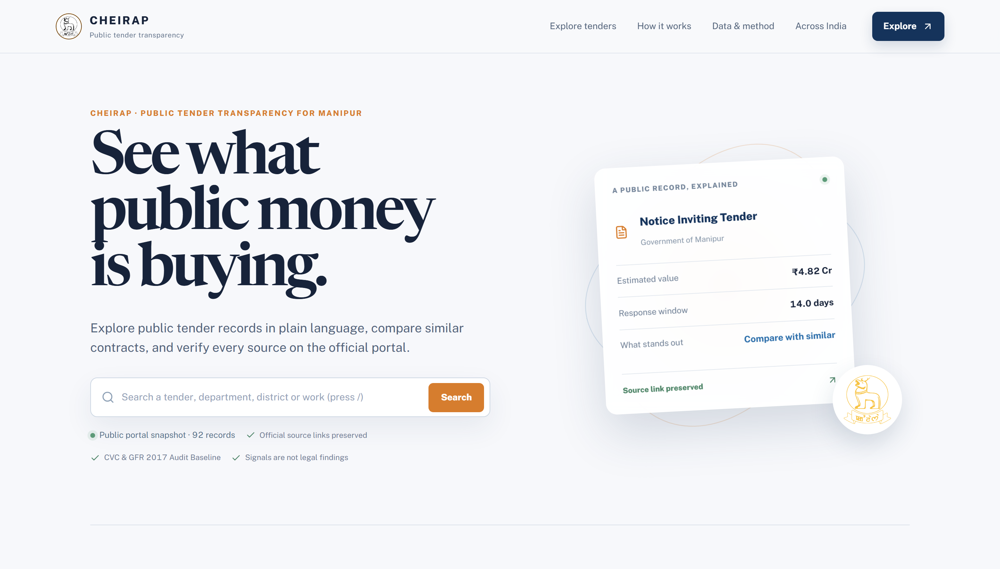
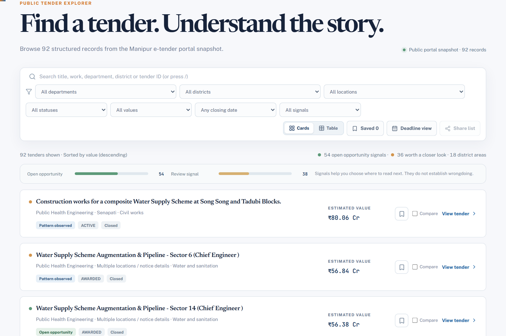
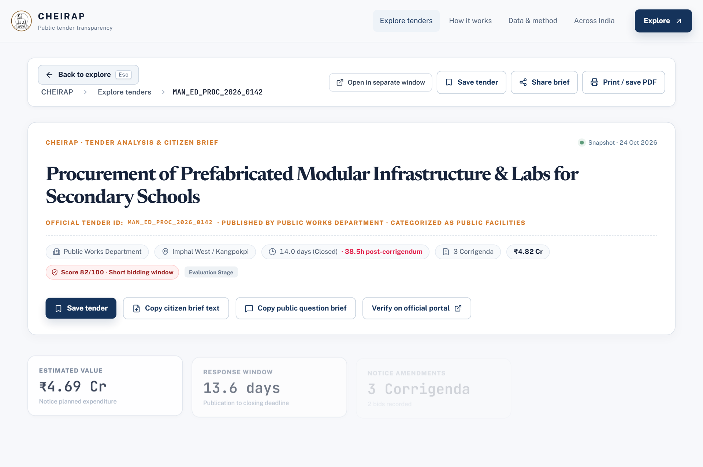
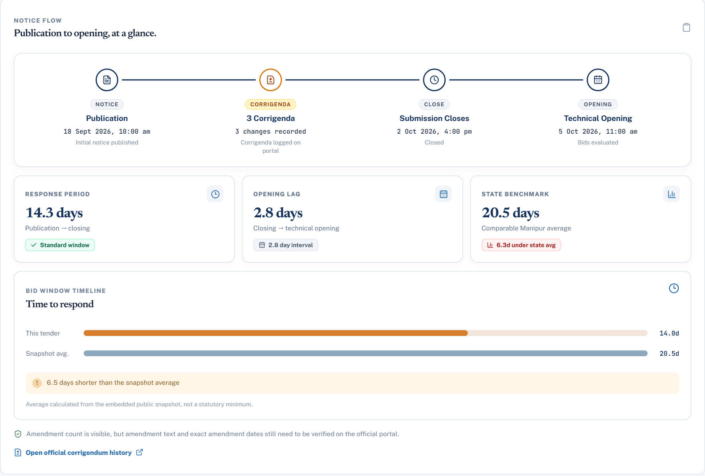
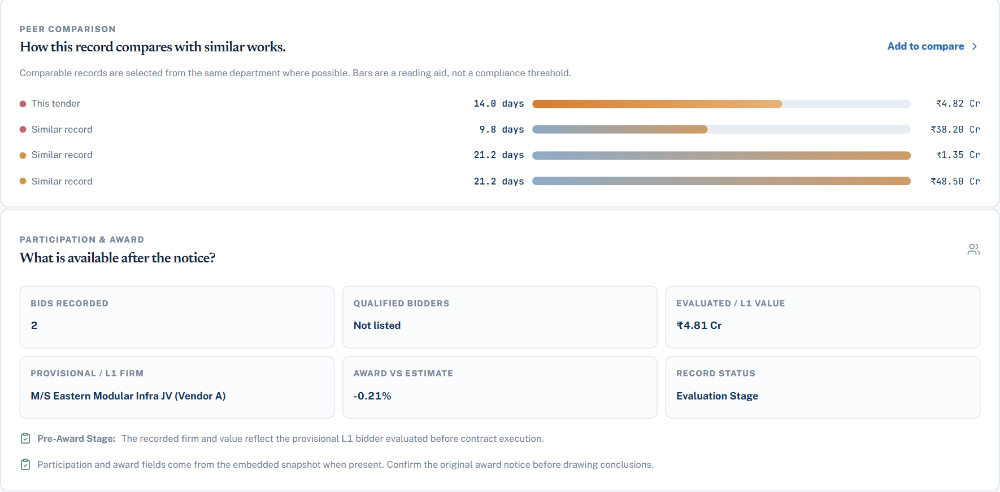
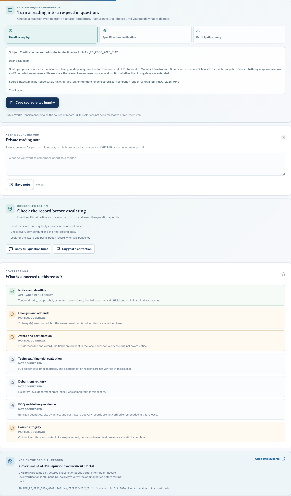
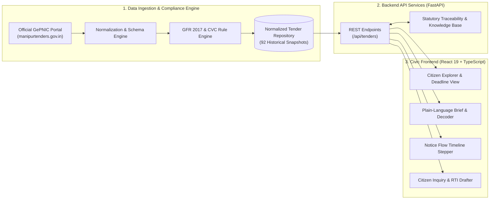

# CHEIRAP (ꯆꯩꯔꯥꯞ)

> **Public Tender Transparency & Civic Vigilance for Manipur**  
> *"See what public money is buying."*

[](https://opensource.org/licenses/MIT)
[](https://mybharat.gov.in/vbyld-2027)
[]()
[]()



---

## Project Overview

**CHEIRAP** (Meetei Mayek: `ꯆꯩꯔꯥꯞ`, historically referring to the traditional court of justice and civic assembly in Manipur) is an autonomous, open-source public procurement transparency platform. It transforms complex, fragmented government e-tender notices into understandable, comparable, and source-verified citizen briefs.

* **Competition**: **Hack for Social Cause (HSC 2027)** under **Viksit Bharat Young Leaders Dialogue (VBYLD)**
* **Organized by**: Ministry of Youth Affairs & Sports (MoYAS), Government of India
* **Knowledge Partner**: Indian Institute of Technology Bombay (GISE Hub & SJMSoM)
* **Thematic Area**: **Theme 4 — Governance & Civic Technology** *(with cross-impact on Theme 7: AI & Emerging Tech and Theme 6: Digital Inclusion)*
* **Team Name**: **Team Lotux** (Manipur)
* **Team Members**:
  * Waikhom Preety Devi
  * Yumnam Adit Singh

---

## The Problem: The Civic Procurement Gap

Public procurement accounts for nearly **20% to 25% of India's GDP**, funding critical schools, roads, medical centers, and public infrastructure. In Manipur—a border state where logistical costs and infrastructure resilience are paramount—every public rupee counts.

While official portals like the National Informatics Centre (NIC) GePNIC (`manipurtenders.gov.in`) make tender notices *technically available*, they remain *practically inaccessible* to citizens, journalists, and community leaders:

1. **Information Asymmetry**: Notices are buried in technical codes, multi-page PDFs, and fragmented portal pages.
2. **Compressed Bidding Windows**: High-value tenders are often modified by rapid, consecutive corrigenda, compressing the remaining bidding window to less than 72 hours—restricting fair participation without formally violating portal defaults.
3. **Absence of Plain Language**: Procurement legalisms obscure basic questions: *Who is procuring? What is being bought? How much money is involved? Where is the site?*
4. **Linguistic Exclusion**: Lack of bilingual access in the constitutional **Meetei Mayek** script alongside English.

```
[Official Portal PDF] ──> [Dense Legal Jargon] ──> [Information Gap] ──> Irreversible Contracts
                                                            │
                                                     [CHEIRAP LAYER]
                                                            │
                                               Actionable Civic Transparency
```

---

## The Solution: What CHEIRAP Does

CHEIRAP acts as an intelligent comprehension layer between complex government portals and public questions. It adheres to **CVC (Central Vigilance Commission)** guidelines and **General Financial Rules (GFR 2017 Rule 161)** without ever making accusatory or speculative claims.

### Core Features

* **Citizen Tender Explorer**: Search and filter Manipur tenders across departments, districts, values, and closing dates with an intuitive **Deadline View**.
* **Plain-Language Executive Brief**: Converts 80-page tenders into 4 clear citizen anchors:
  * *Who is procuring?* (Department & administrative chain)
  * *What is being bought?* (Scope & deliverables)
  * *Where is it located?* (District & PIN code)
  * *What does the budget mean?* (Estimated expenditure, EMD security, tender fee)
* **Visual Notice Flow Timeline Stepper**: A continuous 4-stage milestone progression (Notice → Amendments → Submission Closes → Technical Opening) that highlights when post-corrigendum response windows are compressed below 72 hours (CVC / GFR Rule 161).
* **Peer Comparison Benchmark**: Automatically benchmarks a tender's duration and estimated expenditure against historical tenders from the same department to contextualize outliers.
* **Citizen Action & Inquiry Generator**: One-click generation of polite, evidence-based inquiry letters citing specific Tender IDs, dates, and official URLs for RTI (Right to Information) filings or community oversight.
* **Bilingual Meetei Mayek Support**: Complete rendering in the indigenous Meetei Mayek script (`ꯆꯩꯔꯥꯞ`) alongside English for genuine regional inclusion.
* **100% Provenance & Source Traceability**: Direct one-click verification links back to the original `manipurtenders.gov.in` record.

---

## Product Walkthrough & Differentiating Features

### 1. Citizen Tender Explorer & Deadline View
*Intuitive search with live department filtering, deadline calendar views, and objective CVC vigilance chips.*


---

### 2. Tender Transparency Brief & Plain-Language Decoder
*Decodes dense 80-page procurement documents into 4 essential citizen anchors with instant official portal verification.*


---

### 3. Visual Timeline Stepper & Corrigenda Window Tracker
*Maps the lifecycle from notice to opening, alerting citizens when late corrigenda compress the bidding window below 72 hours.*


---

### 4. Departmental Peer Comparison Benchmark
*Compares tender durations and budgets against historical departmental averages to identify unusual compression or inflation.*


---

### 5. Citizen Action: Source-Cited Inquiry & RTI Drafter
*Empowers citizens, journalists, and CSOs to generate polite, clause-cited inquiry drafts with zero legal barrier.*


---

## Architecture & Tech Stack



### Technology Stack
* **Frontend**: React 19, TypeScript, Vite, Tailwind CSS v4, Lucide Icons, GSAP (GreenSock) for accessible UI motion.
* **Backend**: FastAPI, Uvicorn, Python 3.12, Pydantic schemas.
* **Storage & Privacy**: Zero server tracking; bookmarks, private notes, and draft inquiries remain securely in the citizen's browser storage.
* **Performance**: Sub-100ms local interaction response; fully responsive across desktop, tablet, and mobile.

---

## Getting Started

### Prerequisites
* **Node.js**: v18+ (v20+ recommended)
* **Python**: 3.10+
* **Git**

### Installation

1. **Clone the repository**:
   ```bash
   git clone https://github.com/haapuchu/cheirap.git
   cd cheirap
   ```

2. **Install Python backend dependencies**:
   ```bash
   pip install -r requirements.txt
   ```

3. **Install Frontend dependencies**:
   ```bash
   cd web
   npm install
   cd ..
   ```

### Running Locally

1. **Start the FastAPI Backend Service** (Port 8000):
   ```bash
   python -m uvicorn server.app:app --host 0.0.0.0 --port 8000 --reload
   ```

2. **Start the Vite Frontend Dev Server** (Port 5173):
   ```bash
   npm --prefix web run dev
   ```

3. **Open the App**:
   Navigate to [http://localhost:5173](http://localhost:5173) in your browser.

---

## Sample Demonstration Tenders

* **Tender ID `MAN_ED_PROC_2026_0142`**: *Procurement of Prefabricated Modular Infrastructure & Labs for Secondary Schools* (₹4.82 Cr, 3 Corrigenda, short response window).
* **Tender ID `2026_MSPDC_3473_1`**: *High-voltage power supply distribution works* (Complete timeline stepper lifecycle).
* **Tender ID `2026_FDM_3484_2`**: *Forest Department conservation logistics* (Standard 20-day open window).

---

## Regional Scalability (Northeast Expansion)

While seeded with Manipur procurement data, CHEIRAP's normalized data dictionary is engineered to support e-tender portals across the Northeast:
* **Assam**: `assamtenders.gov.in`
* **Meghalaya**: `meghalayatenders.gov.in`
* **Tripura**: `tripuratenders.gov.in`
* **Mizoram**: `mizoramtenders.gov.in`
* **Nagaland**: `nagalandtenders.gov.in`

---

## Alignment with UN Sustainable Development Goals (SDGs)

* **SDG 16.6**: Develop effective, accountable, and transparent institutions at all levels.
* **SDG 16.10**: Ensure public access to information and protect fundamental freedoms in accordance with national legislation.
* **SDG 9.1**: Develop quality, reliable, sustainable, and resilient infrastructure for economic development and human wellbeing.

---

## Responsible Use & Legal Neutrality Disclaimer

CHEIRAP is an educational, civic-information, and decision-support layer. It is **not** a court of law, a formal vigilance authority, or an enforcement agency. All flags (such as *"Short bidding window"* or *"Several changes recorded"*) are **review signals** designed to encourage public scrutiny of original records—never accusations of wrongdoing. All claims link directly to the official government source for independent verification.

---

## License

This project is open-source and distributed under the **MIT License**. See the [LICENSE](LICENSE) file for details.

---

**Team Lotux** · *Viksit Bharat Young Leaders Dialogue (VBYLD 2027)*  
*Waikhom Preety Devi & Yumnam Adit Singh*
